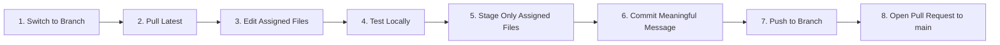

# LensLab Studio — Team Collaboration & Member Contribution Guide

**Project:** LensLab Studio – Camera Rental Management System  
**Repository:** [https://github.com/Nithish-2007-web/Lens-Lab-Studio](https://github.com/Nithish-2007-web/Lens-Lab-Studio)  
**Architecture:** Node.js • Express.js • SQLite3  
**Team Allocation Model:** Exactly Five Members (Strict Module Separation & Dedicated Branches)  

---

## 1. Team Allocation Overview

The LensLab Studio backend architecture is intentionally decoupled into five distinct functional domains. Each domain is exclusively owned and maintained by an assigned team member on their dedicated Git branch to ensure clean code boundaries, zero merge conflicts, clear accountability, and effortless defense during academic evaluations and viva examinations.

| Member | Assigned Domain | Git Branch Name | Files Owned | Primary Deliverables |
| :--- | :--- | :--- | :--- | :--- |
| **Member 1** | **Backend Server and Routing** | `member-1-backend` | `server.js`<br>`routes.js` | Express app initialization, body-parser middleware, modular routing architecture, root health check, 404 handler, route order priority rules, and server startup lifecycle. |
| **Member 2** | **Database Management** | `member-2-database` | `database/database.js` | Asynchronous SQLite connection (`lensLab.db`), `PRAGMA foreign_keys = ON;`, schema definitions (`photographers`, `cameras`, `rentals`), clean unseeded cameras table, singleton DB getter. |
| **Member 3** | **REST API Development** | `member-3-api` | `endpoints.js` | Camera CRUD operations, photographer registration and listing, rental booking, multi-table relational `INNER JOIN` query, and foreign key conflict handling (HTTP 409). |
| **Member 4** | **Validation and Summary** | `member-4-validation` | `validation.js`<br>`summary.js` | Express validation middleware (`validateCamera`), parameterized query search by camera kind (`?kind=...`), and inventory aggregation using SQL `GROUP BY` (`GET /cameras/summary`). |
| **Member 5** | **Testing and Documentation** | `member-5-testing-docs` | `postman/`<br>`api.http`<br>`README.md`<br>`screenshots/`<br>`MEMBER_CONTRIBUTION_GUIDE.md` | Postman Collection v2.1.0 test suite (41 tests), VS Code REST Client collection, visual verification screenshots, ER diagrams, flowchart, and comprehensive technical documentation. |

> [!IMPORTANT]
> **Strict File Ownership Rule:** Each member must make modifications **ONLY** to their assigned files. Never edit files belonging to other team members without explicit prior discussion and consensus. This eliminates code collisions and keeps pull requests clean and reviewable.

---

## 2. Git Branch Structure and Architecture

```
main (Default Production Branch)
├── member-1-backend       (Member 1: server.js, routes.js)
├── member-2-database      (Member 2: database/database.js)
├── member-3-api           (Member 3: endpoints.js)
├── member-4-validation    (Member 4: validation.js, summary.js)
├── member-5-testing-docs  (Member 5: postman/, api.http, README.md, screenshots/)
└── repo-restructure       (Archive Branch: Baseline Restructuring Reference)
```

- **`main`**: The protected production branch containing the verified, integrated application. No developer pushes directly to `main`.
- **Member Branches (`member-*`)**: Feature branches where each developer implements and refines their assigned components.
- **`repo-restructure`**: Preserved historical archive documenting the initial architecture transformation.

---

## 3. Git Setup and Getting Started

### 3.1 Install Git
If Git is not yet installed on your Windows system:
1. Download Git from [https://git-scm.com/download/win](https://git-scm.com/download/win).
2. Run the installer, keeping standard defaults (ensure "Git Credential Manager" is enabled).
3. Verify installation in PowerShell:
   ```powershell
   git --version
   ```

### 3.2 Configure Your Identity
Run these commands once to set your commit author name and email:
```powershell
git config --global user.name "Your Name"
git config --global user.email "your.email@example.com"
```

### 3.3 Clone the Repository
Clone the project repository to your local machine and navigate into it:
```powershell
git clone https://github.com/Nithish-2007-web/Lens-Lab-Studio.git
cd Lens-Lab-Studio
```

### 3.4 Install Project Dependencies
Run `npm install` to install Express, SQLite3, and Nodemon:
```powershell
npm install
```

---

## 4. Daily Member Workflow

Every team member must strictly follow this 8-step cycle for every change:



### Step 1: Switch to Your Assigned Branch
Never make changes on `main`. Switch to your dedicated branch:

- **Member 1:**
  ```powershell
  git switch member-1-backend
  ```
- **Member 2:**
  ```powershell
  git switch member-2-database
  ```
- **Member 3:**
  ```powershell
  git switch member-3-api
  ```
- **Member 4:**
  ```powershell
  git switch member-4-validation
  ```
- **Member 5:**
  ```powershell
  git switch member-5-testing-docs
  ```

### Step 2: Pull the Latest Changes from Origin
Ensure your local branch is synchronized with GitHub:
```powershell
git pull origin <your-branch-name>
# Example for Member 1:
# git pull origin member-1-backend
```

### Step 3: Modify Only Your Assigned Files
Open the project in VS Code (`code .`) and edit only the files allocated to you.

### Step 4: Test Your Changes Locally
Verify that your changes work and do not break the server:
```powershell
npm start
```
Use `api.http` (via the VS Code REST Client extension) or Postman to test your endpoints.

### Step 5: Stage ONLY Your Assigned Files
**Never run `git add .` indiscriminately.** Stage only your specific assigned files:

- **Member 1:**
  ```powershell
  git add server.js routes.js
  ```
- **Member 2:**
  ```powershell
  git add database/database.js
  ```
- **Member 3:**
  ```powershell
  git add endpoints.js
  ```
- **Member 4:**
  ```powershell
  git add validation.js summary.js
  ```
- **Member 5:**
  ```powershell
  git add postman/ api.http README.md screenshots/ MEMBER_CONTRIBUTION_GUIDE.md
  ```

Check status to confirm no extraneous files are staged:
```powershell
git status
```

### Step 6: Commit with a Meaningful Message
Follow conventional commit message prefixes (`feat:`, `fix:`, `docs:`, `test:`):
```powershell
# Examples:
git commit -m "feat(routing): update camera summary route precedence"
git commit -m "feat(database): refine foreign key error handling"
git commit -m "feat(api): optimize rental inner join query"
git commit -m "feat(validation): enhance kind query parameter sanitization"
git commit -m "docs: update API testing screenshots and postman collection"
```

### Step 7: Push to Your Branch on GitHub
Push your commits to your branch on GitHub:
```powershell
git push origin <your-branch-name>
# Example:
# git push origin member-1-backend
```

### Step 8: Open a GitHub Pull Request
1. Navigate to the GitHub repository: [https://github.com/Nithish-2007-web/Lens-Lab-Studio](https://github.com/Nithish-2007-web/Lens-Lab-Studio)
2. Click the **Pull requests** tab, then click **New pull request**.
3. Set the target branches:
   - **Base branch:** `main`
   - **Compare branch:** `<your-branch-name>` (e.g. `member-1-backend`)
4. Fill in the title and description summarizing your changes.
5. Submit the pull request for team review.

---

## 5. Pull Request Review and Merge Checklist

Before merging any Pull Request into `main`, at least one other team member must review the PR against this checklist:

### Pre-Merge Review Checklist
- [ ] **File Scope:** Only the author's assigned files are modified in the "Files changed" tab.
- [ ] **No Secrets:** No `.env`, API keys, tokens, or credentials are committed.
- [ ] **No Binaries or DBs:** No `.db`, `.sqlite`, or `.log` files are committed.
- [ ] **No Dependencies:** `node_modules/` is not committed.
- [ ] **No Duplicate Files:** No temporary copies (e.g. `server_backup.js`, `copy.txt`) exist.
- [ ] **Clean Lint/Syntax:** The code contains no syntax errors or unresolved imports.
- [ ] **Local Verification:** A reviewer can pull the branch and execute `npm start` without crashes.

### Merging the Pull Request
Once approved on GitHub:
1. Use **"Squash and merge"** or standard **"Create a merge commit"** depending on team preference.
2. Confirm the merge into `main`.
3. Keep the member branch active on GitHub for ongoing development.

---

## 6. Synchronizing Your Branch with Main

When another member's PR has been merged into `main`, update your local branch to incorporate the latest changes:

```powershell
# 1. Switch to main and pull latest merged changes
git switch main
git pull origin main

# 2. Switch back to your member branch
git switch <your-branch-name>

# 3. Merge main into your branch
git merge main

# 4. Push updated branch to GitHub
git push origin <your-branch-name>
```

---

## 7. Merge Conflict Resolution Guide

Because each member owns distinct files, merge conflicts should be extremely rare. However, if a conflict occurs (e.g., when syncing `main`):

### How to Resolve Conflicts Step-by-Step
1. Git will notify you of conflicting files during `git merge main`:
   ```powershell
   CONFLICT (content): Merge conflict in <file>
   Automatic merge failed; fix conflicts and then commit the result.
   ```
2. Open the conflicting file in **VS Code**.
3. VS Code highlights conflict blocks:
   ```
   <<<<<<< HEAD (Your Branch)
   ... your code ...
   =======
   ... incoming code from main ...
   >>>>>>> main
   ```
4. Choose the appropriate resolution option at the top of the block:
   - **Accept Current Change:** Keep your branch's version.
   - **Accept Incoming Change:** Keep the version from `main`.
   - **Accept Both Changes:** Keep both sections.
5. Verify the code runs cleanly with `npm start`.
6. Stage the resolved file:
   ```powershell
   git add <resolved-file>
   ```
7. Finalize the merge commit:
   ```powershell
   git commit -m "merge: resolve conflict with main"
   git push origin <your-branch-name>
   ```

---

## 8. Detailed Member Viva & Presentation Guide

---

### Member 1: Backend Server and Routing
- **Branch:** `member-1-backend`
- **Files Owned:** `server.js`, `routes.js`
- **Responsibilities:** Express app setup, `express.json()` body-parsing middleware, route mounting, route ordering priority, 404 handler, and server startup synchronization.
- **Viva Q&A:**
  - *Q:* Why must `GET /cameras/summary` be mounted before `GET /cameras/:cameraId`?
  - *A:* Express evaluates routes sequentially. If `/:cameraId` was mounted first, a request to `/cameras/summary` would match `:cameraId` with `req.params.cameraId = 'summary'`, triggering a camera lookup and returning a 404 instead of calling the summary controller.

---

### Member 2: Database Management
- **Branch:** `member-2-database`
- **File Owned:** `database/database.js`
- **Responsibilities:** SQLite connection, `PRAGMA foreign_keys = ON;`, schema definitions (`photographers`, `cameras`, `rentals`), clean unseeded cameras table, and singleton DB accessor.
- **Viva Q&A:**
  - *Q:* Why is `PRAGMA foreign_keys = ON;` necessary in SQLite?
  - *A:* By default, SQLite disables foreign key constraint checking for backwards compatibility. Explicitly enabling it enforces referential integrity, blocking invalid foreign key insertions in `rentals` and preventing deletion of cameras currently rented.

---

### Member 3: REST API Development
- **Branch:** `member-3-api`
- **File Owned:** `endpoints.js`
- **Responsibilities:** Camera CRUD operations, photographer registration/listing, rental booking, multi-table relational `INNER JOIN` query, and foreign key conflict handling (HTTP 409).
- **Viva Q&A:**
  - *Q:* How does the `getRentals` query combine data across three tables?
  - *A:* It executes an SQL `INNER JOIN` connecting `rentals.photographer_id = photographers.photographer_id` and `rentals.camera_id = cameras.camera_id`, replacing raw IDs with human-readable names and equipment details.

---

### Member 4: Validation and Summary
- **Branch:** `member-4-validation`
- **Files Owned:** `validation.js`, `summary.js`
- **Responsibilities:** Express validation middleware (`validateCamera`), parameterized search by kind (`?kind=...`), and SQL `GROUP BY` inventory aggregation handler (`GET /cameras/summary`).
- **Viva Q&A:**
  - *Q:* Why use parameterized queries (`WHERE kind = ?`)?
  - *A:* Parameterization ensures user inputs are treated strictly as data literals by the database parser, eliminating SQL injection vulnerabilities.

---

### Member 5: Testing and Documentation
- **Branch:** `member-5-testing-docs`
- **Files Owned:** `postman/`, `api.http`, `README.md`, `screenshots/`, `MEMBER_CONTRIBUTION_GUIDE.md`
- **Responsibilities:** Postman Collection v2.1.0 (41 tests), VS Code REST Client script, comprehensive technical documentation, ER diagrams, flowchart, and test screenshots.
- **Viva Q&A:**
  - *Q:* How were the 3 twist tests verified?
  - *A:* Test 3 was validated initially with an empty table returning `[]`, Test 1 by inserting DSLR and Mirrorless cameras, Test 2 by verifying aggregated counts (`DSLR: 2`, `Mirrorless: 1`), and teardown by deleting all cameras and verifying return to `[]`.

---

## 9. Final Verification Checklist

Before submission or faculty evaluation:
- [x] All 6 branches exist on GitHub (`main`, `member-1-backend`, `member-2-database`, `member-3-api`, `member-4-validation`, `member-5-testing-docs`)
- [x] `main` is set as the default branch on GitHub
- [x] All member branches are synchronized with `main`
- [x] Application boots cleanly with `npm start`
- [x] All 41 automated API tests pass with 0 failures
- [x] `.gitignore` prevents leaks of `node_modules`, `.env`, and `*.db`
