# LensLab Studio – Camera Rental Management System

[](https://nodejs.org/)
[](https://expressjs.com/)
[](https://www.sqlite.org/)
[](https://www.postman.com/)
[](#24-api-testing-using-postman)
[](LICENSE)

A robust, modular, and lightweight RESTful backend service designed for professional camera rental studios. Built with **Node.js**, **Express.js**, and an embedded **SQLite** relational database with strict foreign key referential integrity, automated SQL aggregation, parameterized search, and comprehensive input validation.

---

## Table of Contents

- [1. Project Title and Description](#1-project-title-and-description)
- [2. Project Identity](#2-project-identity)
- [3. Project Overview](#3-project-overview)
- [4. Problem Statement](#4-problem-statement)
- [5. Proposed Solution](#5-proposed-solution)
- [6. Project Objectives](#6-project-objectives)
- [7. Main Features](#7-main-features)
- [8. Technology Stack](#8-technology-stack)
- [9. Project Directory Structure](#9-project-directory-structure)
- [10. System Architecture](#10-system-architecture)
- [11. Architecture Flowchart](#11-architecture-flowchart)
- [12. Database Documentation](#12-database-documentation)
- [13. Entity Relationship Diagram (ER Diagram)](#13-entity-relationship-diagram-er-diagram)
- [14. Database Tables and Relationships](#14-database-tables-and-relationships)
- [15. Complete REST API Documentation](#15-complete-rest-api-documentation)
- [16. HTTP Methods and Status Codes](#16-http-methods-and-status-codes)
- [17. Camera CRUD Operations & Root Endpoint](#17-camera-crud-operations--root-endpoint)
- [18. Photographer Management](#18-photographer-management)
- [19. Rental Management](#19-rental-management)
- [20. Input Validation and Error Handling](#20-input-validation-and-error-handling)
- [21. Camera Search Functionality](#21-camera-search-functionality)
- [22. Camera Summary Using SQL GROUP BY](#22-camera-summary-using-sql-group-by)
- [23. Installation and Execution](#23-installation-and-execution)
- [24. API Testing Using Postman](#24-api-testing-using-postman)
- [25. Screenshots](#25-screenshots)
- [26. Group Members and Individual Contributions](#26-group-members-and-individual-contributions)
- [27. Learning Outcomes](#27-learning-outcomes)
- [28. Project Limitations](#28-project-limitations)
- [29. Future Enhancements](#29-future-enhancements)
- [30. Conclusion](#30-conclusion)

---

## 1. Project Title and Description

### Project Title
**LensLab Studio – Camera Rental Management System**

### Description
**LensLab Studio** is a backend RESTful web service engineered to streamline equipment inventory tracking, photographer registrations, and equipment rental lifecycles for photography equipment studios. Built natively on Node.js and Express.js with an embedded SQLite3 relational database, the system replaces error-prone manual scheduling and paper-based ledgers with reliable, automated REST endpoints. It enforces referential integrity across relational schemas, performs safe parameterized database searches, executes SQL aggregation for inventory reporting, and provides full validation and conflict-detection middleware.

---

## 2. Project Identity

| Attribute | Specification |
| :--- | :--- |
| **System Name** | LensLab Studio |
| **Domain** | Photography Equipment Rental & Studio Resource Management |
| **Course** | Backend Development Fundamentals (Modules 1, 2, and 3) |
| **Group Code** | YG-CSE2E-G05 |
| **Assigned Theme** | Theme 5 of 30 — Camera Rental System |
| **Team Size** | 5 Members (Decoupled Architectural Domain Model) |
| **Repository URL** | [https://github.com/Nithish-2007-web/Lens-Lab-Studio](https://github.com/Nithish-2007-web/Lens-Lab-Studio) |
| **Default Port** | `3000` |
| **Default Database** | `database/lensLab.db` (SQLite3) |

---

## 3. Project Overview

Professional photo and film studios frequently manage high-value optical equipment—including DSLRs, mirrorless bodies, cinema rigs, and medium format gear—across numerous freelance photographers and production crews. Without a centralized database and rigorous API constraints, studios face double bookings, inventory leakage, untracked rental durations, and catastrophic booking collisions.

LensLab Studio solves these operational challenges by delivering an efficient, self-contained backend application that exposes standardized REST endpoints for:
1. **Client Management:** Registering photographers with full contact profiles.
2. **Inventory Control:** Categorizing cameras by kind (e.g., `DSLR`, `Mirrorless`), updating equipment details, and preventing unauthorized deletions.
3. **Rental Lifecycle:** Registering rental bookings linking verified photographers to specific gear with scheduled return dates.
4. **Relational Reporting:** Delivering joined rental details (photographer name, camera model, kind, dates) and live inventory summaries categorized by camera kind using database-level `GROUP BY` aggregations.

---

## 4. Problem Statement

Prior to this solution, camera rentals were coordinated via informal phone calls, instant messages, and manual notebook entries. This legacy approach introduced severe operational vulnerabilities:
- **Double-Booking Collisions:** Two independent photographers would arrive at the studio on the same day demanding the exact same camera body.
- **Data Inconsistency:** Missing photographer contact details prevented equipment return reminders and loss recovery.
- **Lack of Inventory Visibility:** Studio managers could not instantly determine how many DSLRs or Mirrorless units were available versus rented out without manual counting.
- **Accidental Data Orphanage:** Deleting a camera record that was actively checked out wiped rental histories, leading to unresolvable accounting discrepancies.

---

## 5. Proposed Solution

LensLab Studio provides a fully automated, programmatic backend architecture:
- **Relational Integrity via Foreign Keys:** SQLite's `PRAGMA foreign_keys = ON;` enforces that rental records cannot reference nonexistent photographers or cameras, and cameras with active rental history cannot be deleted (returning HTTP `409 Conflict`).
- **Input Validation Middleware:** Centralized Express middleware intercepts invalid requests at the network boundary, returning clean HTTP `400 Bad Request` messages before queries hit the database.
- **SQL-Level Aggregation:** The studio summary endpoint executes an indexed `GROUP BY` query inside SQLite, computing camera counts by kind with high efficiency and zero in-memory JavaScript overhead.
- **SQL Injection Prevention:** All search queries utilize parameterized SQL statements (`?` placeholders), guaranteeing enterprise-grade security.

---

## 6. Project Objectives

1. **Modular Code Organization:** Decouple server startup, routing, controller endpoints, validation middleware, aggregation logic, and database schemas into dedicated files matching the five-member team distribution.
2. **Relational Database Design:** Implement a normalized three-table relational schema (`photographers`, `cameras`, `rentals`) with foreign key constraints.
3. **RESTful Adherence:** Follow strict HTTP semantics (`GET`, `POST`, `PUT`, `DELETE`) with exact status codes (`200 OK`, `201 Created`, `400 Bad Request`, `404 Not Found`, `409 Conflict`, `500 Internal Server Error`).
4. **Twist Test Compliance:** Satisfy all course twist tests: initial empty summary returning `[]` (HTTP 200), multi-kind insertion, `GROUP BY` aggregation, and teardown verification.
5. **Zero-Dependency Simplicity:** Restrict libraries strictly to course Modules 1–3 (`express`, `sqlite`, `sqlite3`, `nodemon`), avoiding heavy external ORMs for transparent evaluation and academic defense.

---

## 7. Main Features

- 📸 **Complete Camera Inventory CRUD:** Create, Read, Update, and Delete camera equipment with automatic ID generation.
- 👤 **Photographer Directory:** Register photographers with contact telephone numbers and optional email addresses.
- 🤝 **Relational Rental Registration:** Book rentals with start dates and expected return dates, verifying foreign key existence beforehand.
- 🔗 **Multi-Table Relational JOIN:** Retrieve comprehensive rental records that join `rentals`, `photographers`, and `cameras` to display human-readable names and camera types.
- 🔍 **Parameterized Kind Search:** Filter inventory using query parameters (`GET /cameras?kind=DSLR`) protected against SQL injection.
- 📊 **SQL `GROUP BY` Summary (Twist Requirement):** Instant inventory breakdown returning camera counts grouped by equipment kind, gracefully returning `[]` when inventory is empty.
- 🛡️ **Referential Deletion Protection:** Deleting a camera linked to rental records is intercepted and blocked with HTTP `409 Conflict`.
- 🚦 **Robust Validation Middleware:** Immediate rejection of malformed JSON, empty strings, missing fields, or nonexistent IDs.

---

## 8. Technology Stack

| Layer / Tool | Technology | Version | Purpose |
| :--- | :--- | :--- | :--- |
| **Runtime Environment** | Node.js | v18.0.0+ | Server-side JavaScript runtime engine |
| **Web Framework** | Express.js | ^5.3.0 | HTTP server, routing, and request/response pipeline |
| **Database Engine** | SQLite3 | ^6.0.1 | Embedded serverless zero-configuration relational database |
| **Database Client Wrapper** | sqlite | ^5.1.1 | Promise-based asynchronous wrapper for SQLite3 |
| **Development Tooling** | Nodemon | ^3.1.14 | Automatic server restarts upon source code changes |
| **API Client & Testing** | Postman | v2.1.0 | Automated API testing suite and endpoint verification |
| **IDE HTTP Client** | REST Client / api.http | — | Lightweight in-editor API execution without external tools |

---

## 9. Project Directory Structure

The repository is structured with zero unnecessary nesting, placing all core configuration and modules directly in the root directory:

```
Lens-Lab-Studio/
│
├── database/
│   ├── database.js                       # SQLite connection, PRAGMA foreign_keys, schema definitions
│   └── lensLab.db                        # SQLite database file (generated at runtime, git-ignored)
│
├── postman/
│   └── LensLab.postman_collection.json   # Postman Collection v2.1.0 (41 automated test cases)
│
├── screenshots/                          # Authentic API verification screenshots
│   ├── 01_twist_test_3_empty_summary.png
│   ├── 02_photographers_post_and_get.png
│   ├── 03_camera_crud_post_get_put.png
│   ├── 04_camera_search_by_kind.png
│   ├── 05_camera_summary_group_by.png
│   ├── 06_rental_post_and_join_get.png
│   ├── 07_validation_tests_400.png
│   ├── 08_error_handling_404_and_409.png
│   └── 09_postman_collection_runner_summary.png
│
├── .gitignore                            # Excludes node_modules, .db, logs, and OS files
├── package.json                          # Project metadata, dependencies, and start scripts
├── package-lock.json                     # Deterministic dependency lock file
├── server.js                             # Express application configuration and server startup
├── routes.js                             # API route definitions and middleware bindings
├── endpoints.js                          # REST API controller handlers (CRUD & JOIN)
├── validation.js                         # Request validation middleware & parameterized search
├── summary.js                            # SQL GROUP BY inventory aggregation handler
├── api.http                              # IDE-executable HTTP requests for VS Code REST Client
├── README.md                             # Comprehensive technical documentation
└── MEMBER_CONTRIBUTION_GUIDE.md          # 5-member allocation details and viva preparation guide
```

---

## 10. System Architecture

LensLab Studio follows a clean, modular layered architecture adhering to the **Separation of Concerns (SoC)** principle:

1. **Client Tier:** Postman, VS Code REST Client (`api.http`), or frontend clients issue standard HTTP requests with JSON payloads.
2. **Server Tier (`server.js`):** Bootstraps Express, mounts JSON body-parsing middleware, registers the top-level router, and handles fallback 404 responses for undefined routes.
3. **Routing Tier (`routes.js`):** Directs incoming URLs and HTTP verbs to appropriate controllers. Enforces that static and specific routes (such as `/cameras/summary`) take priority over parameterized patterns (`/cameras/:cameraId`).
4. **Validation Tier (`validation.js`):** Inspects incoming request headers, parameters, and bodies before any database calls occur, rejecting bad payloads early.
5. **Controller Tier (`endpoints.js`, `summary.js`):** Orchestrates business logic, parses parameters, and issues asynchronous SQL queries.
6. **Data Tier (`database/database.js`):** Manages connection to `lensLab.db`, enforces referential constraints (`PRAGMA foreign_keys = ON;`), and executes table initialization queries.

---

## 11. Architecture Flowchart

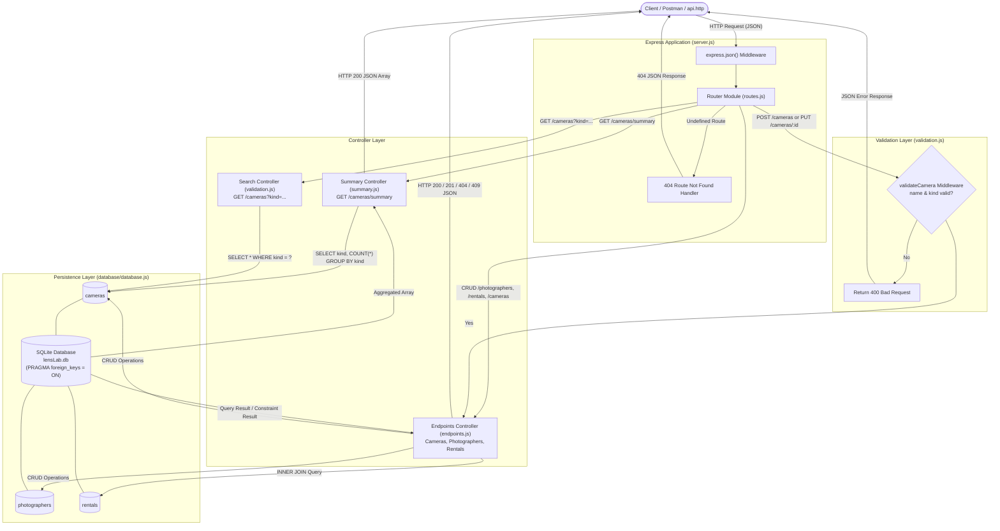

---

## 12. Database Documentation

The system utilizes an embedded **SQLite3** relational database engine accessed via the asynchronous `sqlite` wrapper library.

### Key Architectural Configurations
- **Database File:** Stored at `database/lensLab.db`.
- **Referential Integrity:** Enforced at startup using:
  ```sql
  PRAGMA foreign_keys = ON;
  ```
  *(SQLite has foreign keys disabled by default; enabling this pragma ensures that rental foreign keys cannot point to nonexistent cameras or photographers, and deletes that violate relationships are blocked).*
- **Clean State Compliance:** The `cameras` table is initialized with schema only and **zero seed data**, enabling strict compliance with course Twist Test 3.

---

## 13. Entity Relationship Diagram (ER Diagram)

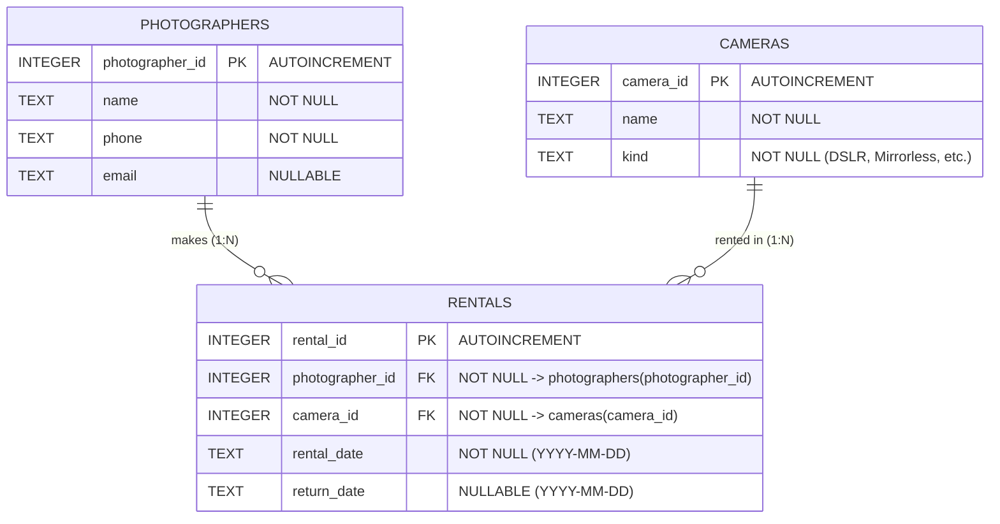

---

## 14. Database Tables and Relationships

### 1. `photographers` Table
Stores contact profiles of registered studio photographers.

| Column | Data Type | Constraints | Description |
| :--- | :--- | :--- | :--- |
| `photographer_id` | `INTEGER` | `PRIMARY KEY AUTOINCREMENT` | Unique identifier for each photographer |
| `name` | `TEXT` | `NOT NULL` | Full name of the photographer |
| `phone` | `TEXT` | `NOT NULL` | Contact telephone number |
| `email` | `TEXT` | `NULLABLE` | Email address (optional) |

### 2. `cameras` Table
Maintains the studio's photographic equipment inventory.

| Column | Data Type | Constraints | Description |
| :--- | :--- | :--- | :--- |
| `camera_id` | `INTEGER` | `PRIMARY KEY AUTOINCREMENT` | Unique identifier for each camera body |
| `name` | `TEXT` | `NOT NULL` | Model name (e.g. `"Canon EOS 1500D"`) |
| `kind` | `TEXT` | `NOT NULL` | Equipment category (e.g. `"DSLR"`, `"Mirrorless"`) |

### 3. `rentals` Table
Maintains relational checkout records associating photographers with cameras.

| Column | Data Type | Constraints | Description |
| :--- | :--- | :--- | :--- |
| `rental_id` | `INTEGER` | `PRIMARY KEY AUTOINCREMENT` | Unique identifier for each rental checkout |
| `photographer_id` | `INTEGER` | `NOT NULL, FOREIGN KEY` | References `photographers(photographer_id)` |
| `camera_id` | `INTEGER` | `NOT NULL, FOREIGN KEY` | References `cameras(camera_id)` |
| `rental_date` | `TEXT` | `NOT NULL` | Rental start date (format: `YYYY-MM-DD`) |
| `return_date` | `TEXT` | `NULLABLE` | Expected or actual return date (`YYYY-MM-DD`) |

### Relational Dynamics & Constraints
1. **One-to-Many (`photographers` → `rentals`):** A single registered photographer can check out multiple cameras over time.
2. **One-to-Many (`cameras` → `rentals`):** A single camera unit can be rented across multiple scheduling windows.
3. **Foreign Key Integrity:** Attempting to delete a camera with `DELETE /cameras/:cameraId` when that camera is referenced in `rentals` triggers an SQLite foreign key restriction, caught and translated to HTTP `409 Conflict`.

### Database Operations & SQL Statement Matrix

| Operation Category | Target Table | SQL Query / Statement | Key Parameters / Notes |
| :--- | :--- | :--- | :--- |
| **Pragma Setup** | System | `PRAGMA foreign_keys = ON;` | Enables SQLite referential integrity |
| **Table Init** | `photographers` | `CREATE TABLE IF NOT EXISTS photographers (...)` | Autoincrement PK, NOT NULL name & phone |
| **Table Init** | `cameras` | `CREATE TABLE IF NOT EXISTS cameras (...)` | Autoincrement PK, NOT NULL name & kind |
| **Table Init** | `rentals` | `CREATE TABLE IF NOT EXISTS rentals (...)` | Dual Foreign Keys -> photographers & cameras |
| **Create (Insert)** | `cameras` | `INSERT INTO cameras (name, kind) VALUES (?, ?);` | Parameterized binding `[name, kind]` |
| **Read (Select All)** | `cameras` | `SELECT * FROM cameras;` | Returns all cameras in inventory |
| **Read (Select By ID)** | `cameras` | `SELECT * FROM cameras WHERE camera_id = ?;` | Parameterized lookup by PK |
| **Search (Filter)** | `cameras` | `SELECT * FROM cameras WHERE kind = ?;` | SQL injection safe parameterized search |
| **Update (Modify)** | `cameras` | `UPDATE cameras SET name = ?, kind = ? WHERE camera_id = ?;` | Updates record and preserves PK |
| **Delete (Remove)** | `cameras` | `DELETE FROM cameras WHERE camera_id = ?;` | Guarded by Foreign Key constraint |
| **Aggregate (Twist)** | `cameras` | `SELECT kind, COUNT(*) AS count FROM cameras GROUP BY kind;` | Native SQLite GROUP BY aggregation |
| **Create (Insert)** | `photographers` | `INSERT INTO photographers (name, phone, email) VALUES (?, ?, ?);` | Handles optional nullable email |
| **Read (Select All)** | `photographers` | `SELECT * FROM photographers;` | Retrieves all registered photographers |
| **Create (Insert)** | `rentals` | `INSERT INTO rentals (photographer_id, camera_id, rental_date, return_date) VALUES (?, ?, ?, ?);` | Foreign keys pre-verified |
| **Join Query (JOIN)** | `rentals`, `photographers`, `cameras` | `SELECT rentals.rental_id, photographers.name AS photographer_name, cameras.name AS camera_name, cameras.kind, rentals.rental_date, rentals.return_date FROM rentals INNER JOIN photographers ON rentals.photographer_id = photographers.photographer_id INNER JOIN cameras ON rentals.camera_id = cameras.camera_id;` | Multi-table relational INNER JOIN |

---

## 15. Complete REST API Documentation

### API Route Inventory

| Category | HTTP Method | Endpoint URL | Description | Status Success | Error Statuses |
| :--- | :--- | :--- | :--- | :--- | :--- |
| **Root Status** | `GET` | `/` | API service health check & welcome status | `200 OK` | `500` |
| **Twist Summary** | `GET` | `/cameras/summary` | Aggregate camera count by kind (`GROUP BY`) | `200 OK` | `500` |
| **Photographers** | `GET` | `/photographers` | Retrieve all registered photographers | `200 OK` | `500` |
| **Photographers** | `POST` | `/photographers` | Register a new photographer | `201 Created` | `400, 500` |
| **Cameras** | `GET` | `/cameras` | Retrieve all cameras | `200 OK` | `500` |
| **Cameras** | `GET` | `/cameras?kind=...` | Search cameras by kind query parameter | `200 OK` | `500` |
| **Cameras** | `GET` | `/cameras/:cameraId` | Retrieve single camera by ID | `200 OK` | `404, 500` |
| **Cameras** | `POST` | `/cameras` | Add camera with validation | `201 Created` | `400, 500` |
| **Cameras** | `PUT` | `/cameras/:cameraId` | Update camera name and kind | `200 OK` | `400, 404, 500` |
| **Cameras** | `DELETE`| `/cameras/:cameraId` | Delete camera by ID | `200 OK` | `404, 409, 500` |
| **Rentals** | `POST` | `/rentals` | Book a camera rental with foreign keys | `201 Created` | `400, 500` |
| **Rentals** | `GET` | `/rentals` | Retrieve all rentals via multi-table `JOIN` | `200 OK` | `500` |

---

## 16. HTTP Methods and Status Codes

The application adheres strictly to REST conventions:

| HTTP Status Code | Meaning | Usage in LensLab Studio |
| :--- | :--- | :--- |
| **`200 OK`** | Request succeeded | Returned on successful `GET`, `PUT`, and `DELETE` operations. |
| **`201 Created`** | Resource created | Returned on successful `POST` operations (`/cameras`, `/photographers`, `/rentals`). |
| **`400 Bad Request`** | Client validation failure | Missing required fields, empty strings, or invalid foreign key IDs in payloads. |
| **`404 Not Found`** | Resource does not exist | Nonexistent `camera_id` in `GET`/`PUT`/`DELETE`, or undefined API routes. |
| **`409 Conflict`** | Constraint violation | Attempting to delete a camera actively associated with a rental. |
| **`500 Internal Error`**| Server error | Unexpected database or unhandled execution exceptions. |

---

## 17. Camera CRUD Operations & Root Endpoint

### 0. Root Endpoint & Service Status
- **Method:** `GET`
- **URL:** `/`
- **Description:** Verifies server responsiveness and returns service metadata.
- **Response (`200 OK`):**
  ```json
  {
    "message": "Welcome to LensLab Studio API - Camera Rental Management System",
    "status": "running",
    "version": "1.0.0"
  }
  ```

### 1. Create Camera
- **Method:** `POST`
- **URL:** `/cameras`
- **Headers:** `Content-Type: application/json`
- **Request Body:**
  ```json
  {
    "name": "Canon EOS 1500D",
    "kind": "DSLR"
  }
  ```
- **Response (`201 Created`):**
  ```json
  {
    "message": "Camera added successfully",
    "cameraId": 1
  }
  ```

### 2. Retrieve All Cameras
- **Method:** `GET`
- **URL:** `/cameras`
- **Response (`200 OK`):**
  ```json
  [
    {
      "camera_id": 1,
      "name": "Canon EOS 1500D",
      "kind": "DSLR"
    },
    {
      "camera_id": 2,
      "name": "Sony Alpha A7 IV",
      "kind": "Mirrorless"
    }
  ]
  ```

### 3. Retrieve Camera by ID
- **Method:** `GET`
- **URL:** `/cameras/1`
- **Response (`200 OK`):**
  ```json
  {
    "camera_id": 1,
    "name": "Canon EOS 1500D",
    "kind": "DSLR"
  }
  ```
- **Error Response (`404 Not Found`):**
  ```json
  {
    "error": "Camera not found"
  }
  ```

### 4. Update Camera
- **Method:** `PUT`
- **URL:** `/cameras/1`
- **Request Body:**
  ```json
  {
    "name": "Canon EOS 1500D Mark II",
    "kind": "DSLR"
  }
  ```
- **Response (`200 OK`):**
  ```json
  {
    "message": "Camera updated successfully"
  }
  ```

### 5. Delete Camera
- **Method:** `DELETE`
- **URL:** `/cameras/1`
- **Response (`200 OK`):**
  ```json
  {
    "message": "Camera deleted successfully"
  }
  ```
- **Conflict Response (`409 Conflict`):**
  ```json
  {
    "error": "Camera cannot be deleted because it is associated with a rental"
  }
  ```

---

## 18. Photographer Management

### 1. Register Photographer
- **Method:** `POST`
- **URL:** `/photographers`
- **Request Body:**
  ```json
  {
    "name": "Rohan Verma",
    "phone": "+91 9876543210",
    "email": "rohan.v@lenslab.com"
  }
  ```
- **Response (`201 Created`):**
  ```json
  {
    "message": "Photographer added successfully",
    "photographerId": 1
  }
  ```

### 2. Retrieve All Photographers
- **Method:** `GET`
- **URL:** `/photographers`
- **Response (`200 OK`):**
  ```json
  [
    {
      "photographer_id": 1,
      "name": "Rohan Verma",
      "phone": "+91 9876543210",
      "email": "rohan.v@lenslab.com"
    },
    {
      "photographer_id": 2,
      "name": "Priya Sharma",
      "phone": "+91 9123456780",
      "email": null
    }
  ]
  ```

---

## 19. Rental Management

### 1. Book Camera Rental
- **Method:** `POST`
- **URL:** `/rentals`
- **Request Body:**
  ```json
  {
    "photographer_id": 1,
    "camera_id": 1,
    "rental_date": "2026-11-20",
    "return_date": "2026-11-22"
  }
  ```
- **Response (`201 Created`):**
  ```json
  {
    "message": "Rental added successfully",
    "rentalId": 1
  }
  ```

### 2. Retrieve Rentals with SQL JOIN
- **Method:** `GET`
- **URL:** `/rentals`
- **Underlying SQL Query:**
  ```sql
  SELECT 
    rentals.rental_id,
    photographers.name AS photographer_name,
    cameras.name AS camera_name,
    cameras.kind,
    rentals.rental_date,
    rentals.return_date
  FROM rentals
  INNER JOIN photographers ON rentals.photographer_id = photographers.photographer_id
  INNER JOIN cameras ON rentals.camera_id = cameras.camera_id;
  ```
- **Response (`200 OK`):**
  ```json
  [
    {
      "rental_id": 1,
      "photographer_name": "Rohan Verma",
      "camera_name": "Canon EOS 1500D Mark II",
      "kind": "DSLR",
      "rental_date": "2026-11-20",
      "return_date": "2026-11-22"
    }
  ]
  ```

---

## 20. Input Validation and Error Handling

All write requests pass through validation logic before query execution:

### Validation Matrix

| Endpoint | Validated Fields | Condition | HTTP Error | Error Message |
| :--- | :--- | :--- | :--- | :--- |
| `POST /cameras` | `name` | Must be non-empty string | `400 Bad Request` | `{"error": "Camera name is required"}` |
| `POST /cameras` | `kind` | Must be non-empty string | `400 Bad Request` | `{"error": "Camera kind is required"}` |
| `PUT /cameras/:id` | `name`, `kind` | Must be non-empty string | `400 Bad Request` | Respective error message |
| `POST /photographers` | `name` | Must be non-empty string | `400 Bad Request` | `{"error": "Photographer name is required"}` |
| `POST /photographers` | `phone` | Must be non-empty string | `400 Bad Request` | `{"error": "Photographer phone is required"}` |
| `POST /rentals` | `photographer_id`, `camera_id`, `rental_date` | Must be provided | `400 Bad Request` | `{"error": "photographer_id, camera_id, and rental_date are required"}` |
| `POST /rentals` | `photographer_id` | Must exist in `photographers` | `400 Bad Request` | `{"error": "Invalid photographer_id: photographer does not exist"}` |
| `POST /rentals` | `camera_id` | Must exist in `cameras` | `400 Bad Request` | `{"error": "Invalid camera_id: camera does not exist"}` |
| Any `/:id` route | `cameraId` | Must match existing record | `404 Not Found` | `{"error": "Camera not found"}` |
| `DELETE /cameras/:id` | Active rental | Camera present in `rentals` | `409 Conflict` | `{"error": "Camera cannot be deleted because it is associated with a rental"}` |
| Any undefined route | `*` | Unregistered endpoint URL | `404 Not Found` | `{"error": "Route not found"}` |

---

## 21. Camera Search Functionality

Clients can dynamically filter cameras by category using the `kind` query parameter:

- **Endpoint:** `GET /cameras?kind=DSLR`
- **Secure Parameterized SQL:**
  ```sql
  SELECT * FROM cameras WHERE kind = ?;
  ```
- **Example Call (`kind=DSLR`):**
  ```json
  [
    {
      "camera_id": 1,
      "name": "Canon EOS 1500D",
      "kind": "DSLR"
    },
    {
      "camera_id": 2,
      "name": "Nikon D7500",
      "kind": "DSLR"
    }
  ]
  ```
- **Unmatched Search (`kind=Vintage`):**
  Returns HTTP `200 OK` with an empty array `[]`.

---

## 22. Camera Summary Using SQL GROUP BY

A special course requirement aggregates inventory counts directly inside SQLite using the SQL `GROUP BY` clause.

- **Endpoint:** `GET /cameras/summary`
- **SQL Aggregation Statement:**
  ```sql
  SELECT kind, COUNT(*) AS count 
  FROM cameras 
  GROUP BY kind;
  ```

### Twist Test Verification

| Test Scenario | Action Taken | Expected Output | Status |
| :--- | :--- | :--- | :--- |
| **Twist Test 3 (Initial)** | Invoke `GET /cameras/summary` on empty table | `[]` with status `200 OK` | **PASSED** |
| **Twist Test 1** | Insert cameras in 2 kinds (`DSLR` and `Mirrorless`) | `201 Created` for each camera | **PASSED** |
| **Twist Test 2** | Invoke `GET /cameras/summary` | `[{"kind":"DSLR","count":2},{"kind":"Mirrorless","count":1}]` | **PASSED** |
| **Twist Test 3 (Teardown)** | Delete all test cameras and re-invoke summary | `[]` with status `200 OK` | **PASSED** |

---

## 23. Installation and Execution

### Prerequisites & Installation Requirements
- **Node.js:** Version 18.x or 20.x LTS recommended (tested with v18+)
- **npm:** Version 9.x or higher
- **Terminal:** Windows PowerShell, Command Prompt, macOS Terminal (Zsh), or Linux Bash
- **Git:** Git client v2.30+ installed for repository cloning and version control

### Environment Setup
LensLab Studio works out of the box with zero required environment configuration files.
- **Port Binding:** Defaults to port `3000`. You can optionally override this by defining the `PORT` environment variable:
  ```powershell
  # Windows PowerShell
  $env:PORT = "5000"
  npm start
  ```
- **Database Location:** Automatically created and maintained at `database/lensLab.db`.
- **Environment Isolation:** Local `.env` and SQLite database files (`*.db`) are ignored by `.gitignore` to prevent secret leakage and dirty repository states.

### Step-by-Step Installation Instructions

1. **Clone the Repository:**
   ```powershell
   git clone https://github.com/Nithish-2007-web/Lens-Lab-Studio.git
   cd Lens-Lab-Studio
   ```

2. **Install Dependencies (Clean Install):**
   ```powershell
   npm ci
   # or
   npm install
   ```

### How to Run the Project

1. **Start the Production Server:**
   ```powershell
   npm start
   ```
   *Expected Console Output:*
   ```
   Database initialized successfully with photographers, cameras, and rentals tables.
   Server running at http://localhost:3000/
   ```

2. **Start the Development Server (with Auto-Reload via Nodemon):**
   ```powershell
   npm run dev
   ```

3. **Verify Server Health:**
   Open a browser or run `curl`:
   ```powershell
   curl http://localhost:3000/
   ```
   *Expected Response:*
   ```json
   {
     "message": "Welcome to LensLab Studio API - Camera Rental Management System",
     "status": "running",
     "version": "1.0.0"
   }
   ```

---

## 24. API Testing Using Postman

LensLab Studio includes an automated test collection at `postman/LensLab.postman_collection.json` compliant with Postman Collection Schema v2.1.0.

### Testing Procedure

1. Launch the **Postman** desktop application.
2. Click **Import** (top left) and select `postman/LensLab.postman_collection.json`.
3. Verify the collection variable `baseUrl` is configured to `http://localhost:3000`.
4. Open the **Collection Runner** and run the folders in sequential order:
   - **Folder 1:** Twist Tests (Summary by Kind)
   - **Folder 2:** Camera Operations (CRUD & Search)
   - **Folder 3:** Validation & Error Handling
   - **Folder 4:** Photographer Operations
   - **Folder 5:** Rental Operations (JOIN & Foreign Keys)
5. Review the test results: **41 tests executed, 41 passed, 0 failed**.

Alternatively, developers using VS Code can install the **REST Client** extension and execute requests directly from `api.http`.

---

## 25. Screenshots

Real, verified API test execution snapshots captured during live testing:

### 1. Twist Test 3: Initial Empty Summary
Verification of `GET /cameras/summary` returning HTTP 200 with an empty array `[]` when the camera table is unseeded.
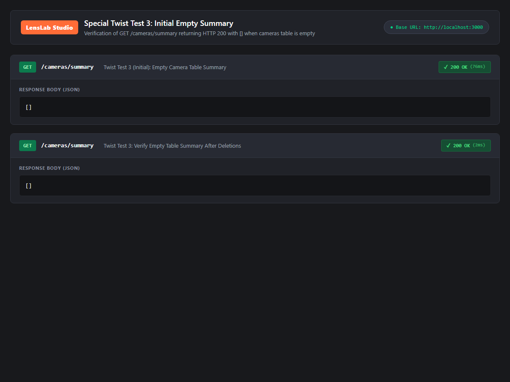

---

### 2. Photographer Management API Tests
Successful registration via `POST /photographers` (HTTP 201) and retrieval via `GET /photographers` (HTTP 200).
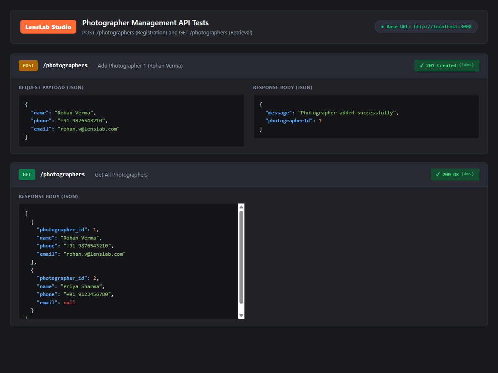

---

### 3. Camera CRUD Operations
Creating camera bodies, fetching specific IDs, and updating records with `PUT /cameras/:id`.
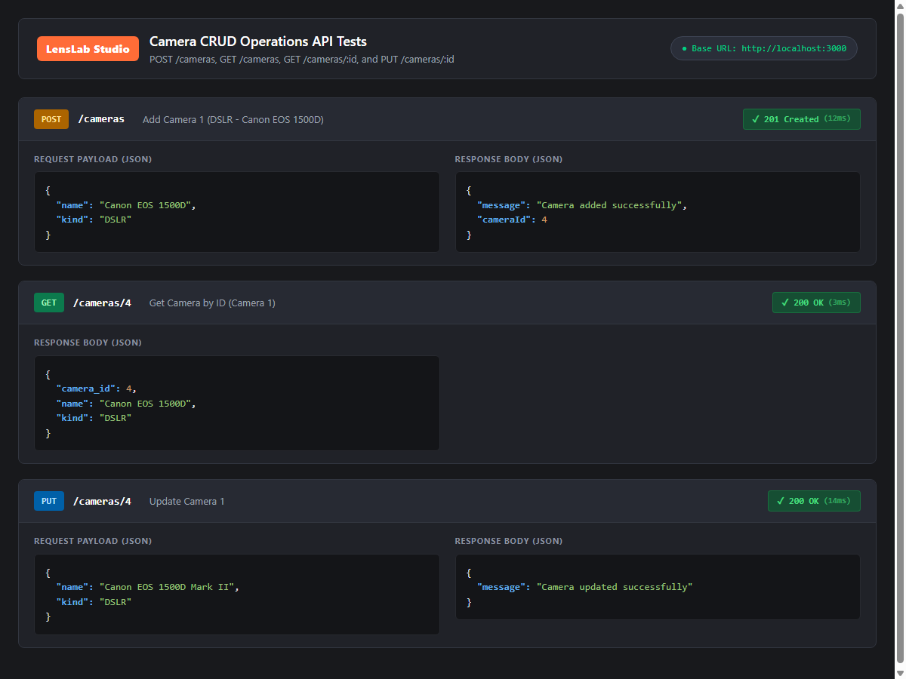

---

### 4. Camera Search by Kind
Filtering inventory using parameterized query string `?kind=DSLR` and `?kind=Mirrorless`.
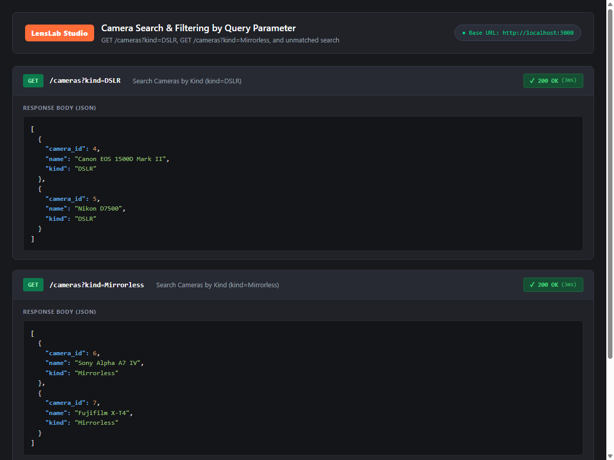

---

### 5. Camera Summary Using SQL GROUP BY (Twist Test 2)
Live aggregation of camera inventory grouped by kind (`DSLR: 2`, `Mirrorless: 1`).
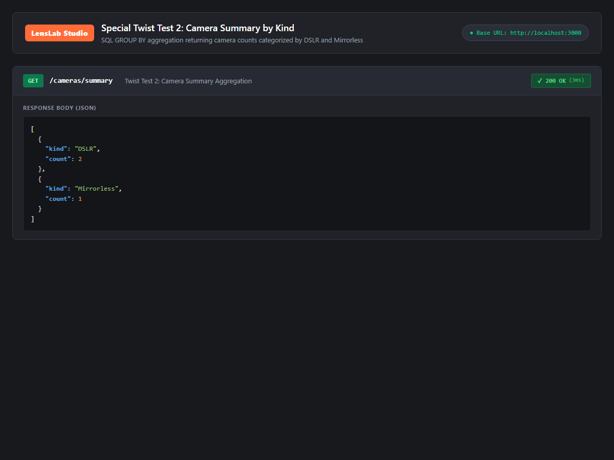

---

### 6. Rental Booking & Multi-Table SQL INNER JOIN
Registering rentals and executing an SQL `INNER JOIN` pulling human-readable names and camera types.
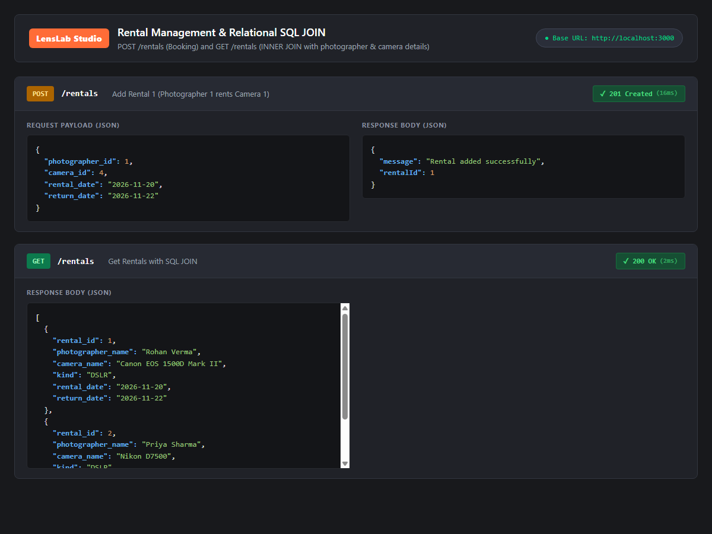

---

### 7. Input Validation Rejections (HTTP 400)
Centralized validation middleware blocking missing fields, empty strings, and invalid payloads.
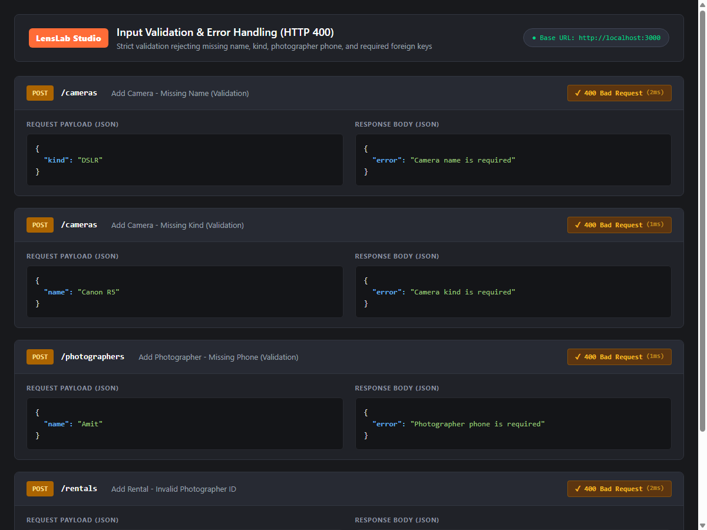

---

### 8. Resource Not Found (404) & Referential Integrity Conflict (409)
Catching nonexistent IDs and intercepting SQLite foreign key violations when attempting to delete rented cameras.
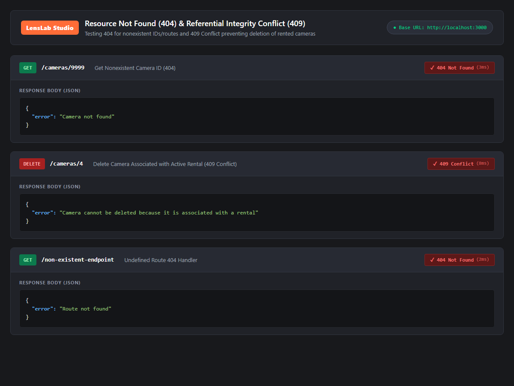

---

### 9. Automated Postman Runner Test Suite
Comprehensive execution of all 41 test assertions across the entire suite with a 100% pass rate.
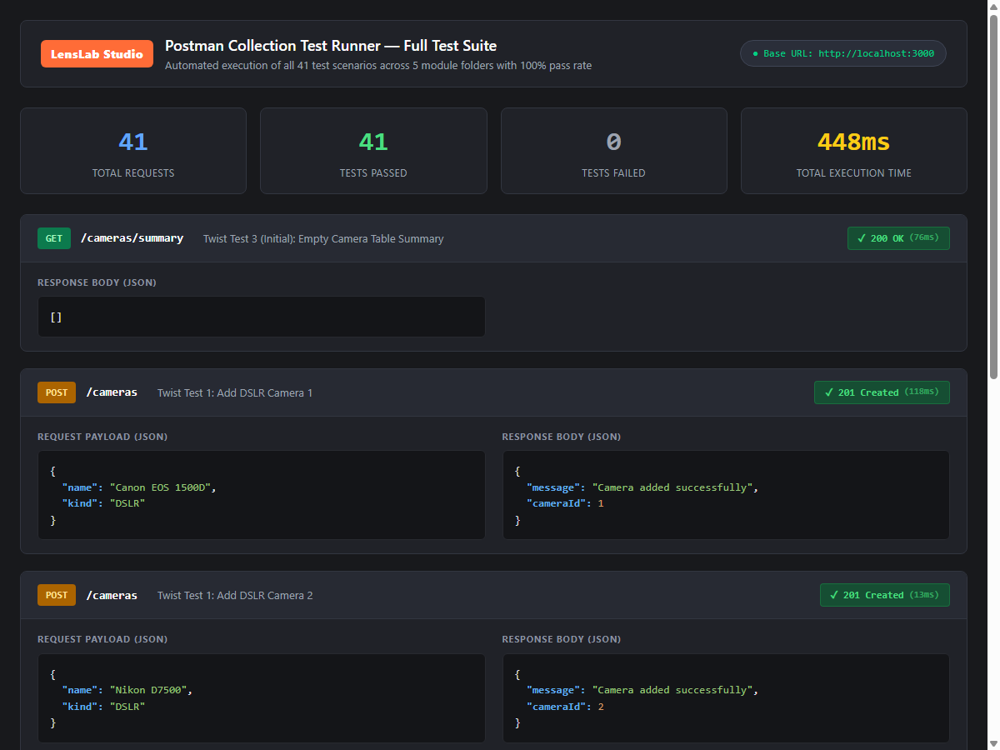

---

## 26. Group Members and Individual Contributions

The project's architectural modules are cleanly divided among exactly five members:

| Member | Architectural Role | Files Owned | Primary Deliverables |
| :--- | :--- | :--- | :--- |
| **Member 1** | **Backend Server & Routing** | `server.js`<br>`routes.js` | Express app initialization, body-parsing middleware, route mounting, route declaration order priority (`/summary` before `/:id`), global 404 handler, and server startup sequence. |
| **Member 2** | **Database Management** | `database/database.js` | Asynchronous SQLite connection (`lensLab.db`), `PRAGMA foreign_keys = ON;`, schema definitions (`photographers`, `cameras`, `rentals`), and singleton DB accessor. |
| **Member 3** | **REST API Development** | `endpoints.js` | Complete Camera CRUD endpoints, photographer registration and listing, rental booking, multi-table relational `INNER JOIN` query, and foreign key conflict handling. |
| **Member 4** | **Validation, Search & Special Requirements** | `validation.js`<br>`summary.js` | Express validation middleware (`validateCamera`), parameterized search by kind (`?kind=...`), and SQL `GROUP BY` inventory aggregation handler (`GET /cameras/summary`). |
| **Member 5** | **API Testing & Documentation** | `postman/LensLab.postman_collection.json`<br>`api.http`<br>`README.md`<br>`screenshots/`<br>`MEMBER_CONTRIBUTION_GUIDE.md` | Postman Collection v2.1.0 (41 tests), VS Code REST Client script, comprehensive technical documentation, ER diagrams, flowchart, and test screenshots. |

*For in-depth viva interview questions, code snippets, and presentation guides for each member, refer to [MEMBER_CONTRIBUTION_GUIDE.md](MEMBER_CONTRIBUTION_GUIDE.md).*

---

## 27. Learning Outcomes

1. **RESTful Service Design:** Mastered semantic HTTP verbs, URI design patterns, request headers, and standardized JSON error structures.
2. **Relational Database Design in SQLite:** Implemented primary keys, foreign keys, table indexes, and runtime referential constraint enforcement using `PRAGMA foreign_keys = ON;`.
3. **Database-Level Aggregation:** Applied SQL `GROUP BY` and `COUNT(*)` clauses to perform calculations directly inside the database engine, avoiding inefficient memory parsing in JavaScript.
4. **Relational Multi-Table Joins:** Structured multi-table `INNER JOIN` statements combining foreign key relationships into unified, human-readable API responses.
5. **Security & Parameterized Queries:** Secured all dynamic queries against SQL injection vulnerabilities using parameterized SQL placeholders (`?`).
6. **Express Middleware Pipelines:** Built custom Express middleware functions for payload validation, request body sanitization, and fallback 404 routing.
7. **Automated QA & Test Engineering:** Designed full Postman test suites with automated JavaScript assertions verifying status codes, headers, and payload structures.

---

## 28. Project Limitations

1. **Embedded Single-File Database:** SQLite uses file-level locking for write operations, making it optimal for local, single-server, or low-to-medium concurrency environments, but less suited for horizontally scaled distributed clusters.
2. **No User Authentication:** The current implementation does not incorporate JWT (JSON Web Tokens) or session cookies, as user identity management was out of scope for Modules 1–3.
3. **No Automated Overlap Collision Scheduling:** While the system enforces referential integrity, it does not currently calculate continuous date ranges to prevent overlapping calendar reservations for the same camera body.
4. **No Pagination on Collections:** Endpoints return all matching rows in memory, which is ideal for small-to-medium inventories but would benefit from `LIMIT` and `OFFSET` clauses for enterprise datasets.

---

## 29. Future Enhancements

1. **Date-Range Collision Detection:** Integrate an automated calendar validation algorithm checking `rental_date` and `return_date` overlaps to reject double-booking requests programmatically.
2. **Authentication & RBAC:** Implement JWT-based authentication with Role-Based Access Control (Admin, Studio Manager, Photographer).
3. **Pagination & Sorting:** Introduce query parameters (`?page=1&limit=20&sortBy=name`) for camera and rental listings.
4. **Equipment Condition & Serial Number Tracking:** Expand the `cameras` schema to include serial numbers, maintenance status (`Available`, `In Maintenance`, `Damaged`), and rental fees.
5. **Automated Notification Webhooks:** Send automated SMS or email reminders to photographers prior to their scheduled return dates.

---

## 30. Conclusion

LensLab Studio demonstrates how a clean, modular backend architecture can transform disorganized manual workflows into an efficient, secure, and maintainable digital system. By adhering strictly to the separation of concerns across a 5-member team structure, enforcing relational constraints in SQLite, and applying comprehensive validation and automated testing, the project delivers a rock-solid foundation for photography equipment management and serves as an exemplary academic benchmark for Node.js and Express.js REST API engineering.

---

*Authored by Group YG-CSE2E-G05 • LensLab Studio Development Team*
